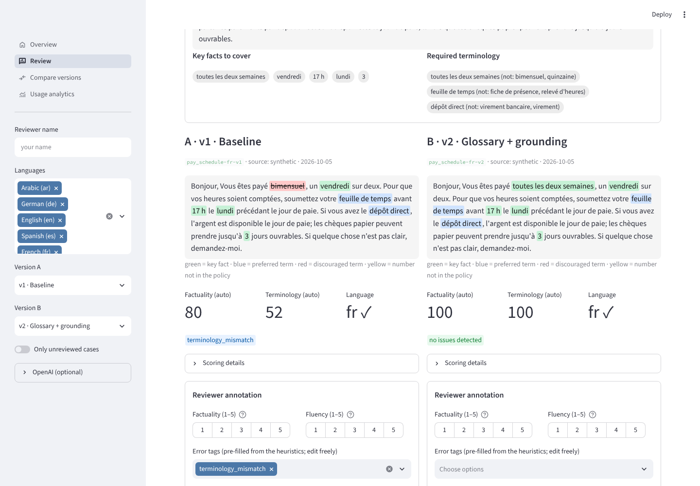
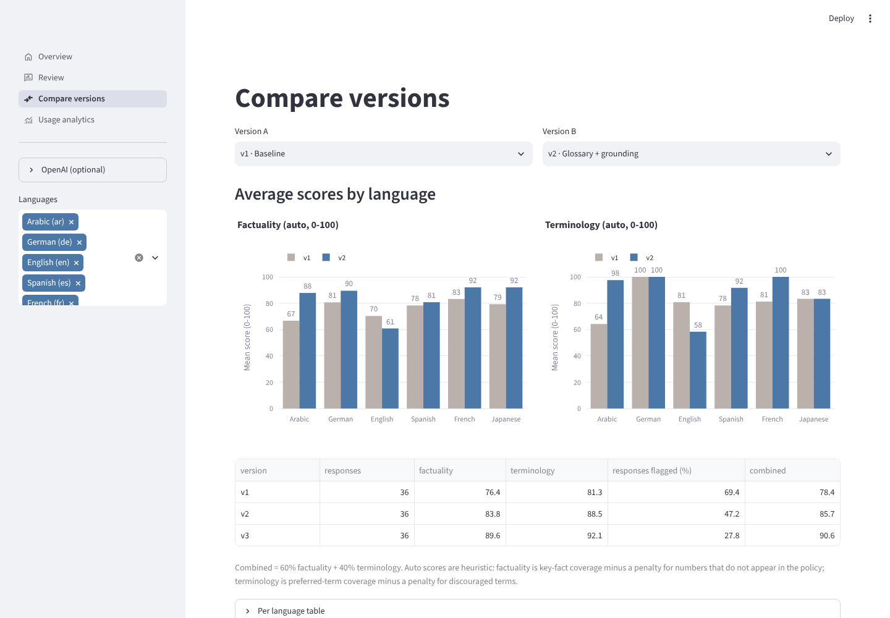
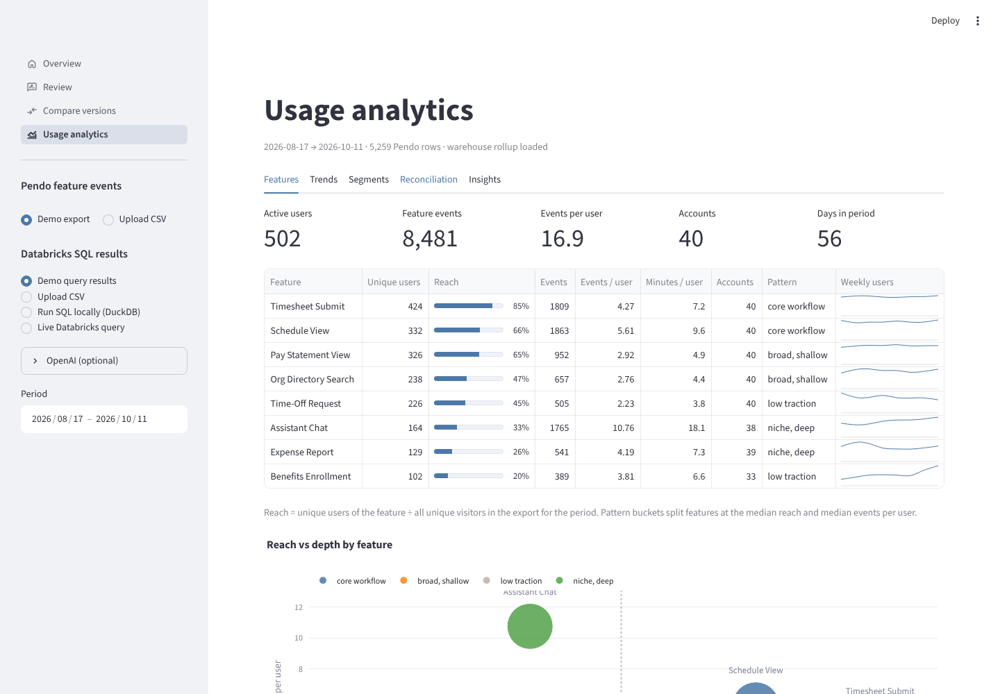

# Polyglot Review

A Streamlit workbench for reviewing an LLM assistant's answers across languages, comparing prompt versions, and reading the product-usage data that says which languages deserve attention.

It grew out of a simple question: when an HR helpdesk assistant answers in French, Japanese or Arabic, how do you know the answer is right, uses the company's terminology, and actually stayed in the target language — and how do you tell whether a new prompt made things better?



## What's in it

**Review** — one case at a time, two prompt versions side by side. Key facts, preferred terms, discouraged terms and unexpected numbers are highlighted in the response. Heuristics pre-fill error tags; the reviewer scores factuality and fluency, edits the tags, writes notes and picks the better answer. Annotations persist to `annotations/` and export as a CSV (UTF-8 with BOM, so Excel opens the Arabic and Japanese rows cleanly).

**Compare versions** — mean factuality and terminology per language and prompt version, head-to-head win rates (auto score, human score, stated preference), tag frequencies, and a calibration table showing how well the auto-tags recover the errors that were deliberately injected into the demo data.

**Usage analytics** — a Pendo-style feature-events export and a weekly rollup from a Databricks SQL query: reach, unique users, events per user, week-over-week movement, locale mix per feature, account concentration, and a reconciliation of the two sources that shows how much mobile/API traffic the front-end instrumentation never sees.

Everything runs offline. With an OpenAI key you can also regenerate any response from a prompt template and grade a response with an LLM judge; with Databricks credentials the rollup query runs live.



## Quick start

```bash
git clone https://github.com/SundusA0/polyglot-review.git
cd polyglot-review
python -m venv .venv
source .venv/bin/activate        # Windows: .venv\Scripts\activate
pip install -r requirements.txt
streamlit run app.py
```

Optional:

```bash
cp .env.example .env             # add OPENAI_API_KEY and/or DATABRICKS_* here
pip install -r requirements-dev.txt && pytest -q
python scripts/generate_synthetic_data.py --seed 7   # regenerate the demo data
```

## How the scoring works

Three signals are computed per response without any model call (`src/scoring.py`):

| Signal | What it does | Score |
|---|---|---|
| Factuality | Checks each key fact of the case (numbers via standalone-token matching, phrases via accent/case-insensitive matching with a fuzzy fallback) and looks for numbers in the response that appear nowhere in the policy context or reference | key-fact coverage × 100, −15 per unexpected number |
| Terminology | Looks up the glossary's preferred term(s) for each concept the case requires and checks for discouraged terms (`data/glossary.csv`, 9 concepts × 6 languages) | preferred-term coverage × 100, −15 per discouraged term |
| Language | Script ranges for Arabic and Japanese, stopword votes for English / French / Spanish / German; also detects an English passage left inside a non-English answer | ✓ / ✗ |

The tag suggester tries to name the cause once instead of every symptom: a cut-off answer is `truncated` rather than `truncated` + `omission`, a replaced glossary term is `terminology_mismatch` rather than also `omission`, and an unexpected number is paired with a missing numeric fact of similar size (`wrong_number`) or reported on its own (`hallucination`, e.g. an invented year).

Limits worth knowing: an invented claim with no number in it is invisible to the heuristics — that is what the LLM judge (`prompts/judge_factuality.md`) and the human are for. Number formats follow the language (`1,25` in French and German, `1.25` elsewhere). Short glossary terms need a word boundary so `OT` does not match `other`; longer Latin terms may continue into a compound (`Überstunden` matches `Überstundenvergütung`).

## Prompt versions

`prompts/versions.json` lists the templates in `prompts/`:

- **v1 baseline** — plain helpful-assistant instruction with the policy context.
- **v2 glossary + grounding** — adds the language-specific glossary block and a rule to answer only from the context, in the user's language.
- **v3 strict numbers + fallback** — v2 plus copy-numbers-verbatim and say-when-the-policy-doesn't-cover-it rules.

Templates use `{language_name}`, `{context}` and `{glossary_block}` placeholders and are rendered by `src/llm.py` when a response is generated live.

## The demo data is synthetic

Nothing here comes from a real company. `scripts/generate_synthetic_data.py` builds:

- **36 review cases** — 6 HR-helpdesk scenarios (PTO accrual, pay schedule, overtime, benefits enrollment, parental leave, expense reimbursement) × 6 languages (en, fr, es, de, ja, ar), each with a question, the policy context, a reference answer, key facts and required glossary concepts (`data/seed/scenarios.json`).
- **108 responses** — three prompt versions per case. Errors are injected with a seeded RNG (omission, wrong number, discouraged term, wrong language, untranslated English passage, truncation, invented sentence) at version-dependent rates, and the injected labels are kept in `responses.csv`. That is what makes the scorer's recall and false-alarm rate measurable; the Compare page shows the numbers.
- **Usage data** — ~40 accounts and ~500 users over 8 weeks with locale, channel and browser; a Pendo-style export of the web app (`Visitor ID, Account ID, Feature, Page, App, Day, Number of Events, …`) that deliberately misses ad-blocked visitors and all mobile/API events; and the weekly rollup produced by running `sql/feature_usage_weekly.sql` over the raw events with DuckDB.

## Usage analytics inputs

The Pendo loader (`src/analytics.normalize_pendo`) accepts the friendly headers a Data Explorer export uses and maps common variants (`Visitor ID` / `visitorId`, `Number of Events` / `Events`, `Language` / `Locale`, …). It needs at least a visitor id, a feature name and a date; events default to 1 per row.

The warehouse side expects the columns the bundled query produces (`week_start, feature_name, product_area, channel, events, unique_users, accounts`). The query is written in the ANSI subset that both Databricks SQL and DuckDB accept, so the same file powers the local demo and the live mode. Metric definitions are stated in the UI: reach = unique users of a feature ÷ all unique visitors in the export for the period; events per user = events ÷ unique users; reconciliation compares Pendo with the warehouse's `web` channel only.



## Project layout

```
app.py                      Streamlit entry point (st.navigation)
views/                      pages: home, review, compare, usage (+ charts, shared helpers)
src/
  textnorm.py               normalisation, numbers, sentence splitting, language heuristic
  scoring.py                factuality / terminology / language scoring and tag suggestion
  analytics.py              Pendo + warehouse metrics, reconciliation, rule-based insights
  llm.py                    optional OpenAI calls (generate, judge, narrate)
  sources.py                demo files, DuckDB runner, Databricks connector
  export.py                 annotated CSV assembly
data/                       cases, responses, glossary, usage data (+ seed/ scenario bank)
prompts/                    prompt templates, versions.json, judge prompt
sql/feature_usage_weekly.sql
scripts/generate_synthetic_data.py
tests/                      scoring unit tests, calibration thresholds, analytics math, headless page smoke tests
```

## Tests

```bash
pytest -q
```

The suite covers the text normalisation edge cases (accents, Arabic letter variants, kana voicing marks, decimal commas, German ordinals, "p. m."), each error detector, the calibration thresholds against the injected labels, the analytics arithmetic on a tiny hand-built frame, that the bundled rollup matches a fresh DuckDB run of the SQL, and a headless Streamlit `AppTest` pass over every page including a save-annotation round trip.

## Roadmap

- Pull Pendo data through the Aggregation API instead of a CSV export.
- Add agreement statistics between reviewers (Cohen's κ on tags) once there is more than one.
- Swap the stopword language heuristic for a small model when more languages are added.
